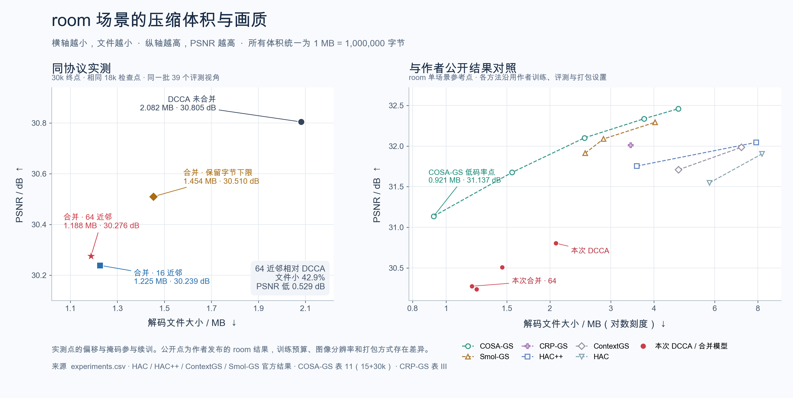

# room 训练内锚点合并实验报告

**截至 2026-11-21，取消预计字节节省下限后，30k 的实际解码文件比保留下限组小 15.70%，解码 PSNR（峰值信噪比）低 0.271 dB。** 该对照覆盖 `room` 的单场景和单种子。来源为 [实验登记表](../data/experiments.csv)，各组实际字节和解码核验见 [原始结果](../../runs/anchor_merge_saving_filter_room_20261120/verified_results.json)。

## 修复学习率后的对照

三组从同一个 18k 检查点出发，使用种子 42、码率损失系数 0.002 和同一训练相机序列。两组合并均在第 18,001 步的首个参数更新前执行，使用 16 个近邻候选和 0.10 的视角响应均方根误差上限。唯一的合并规则差异是预计字节节省下限。各检查点独立编码和解码，在 `room/images_2` 的 39 个持出视角上评测，最长图像宽度为 1600 像素。

| 组别 | 合并次数 | 续训前文件（字节） | 续训前 PSNR（dB） | 30k 文件（字节） | 30k PSNR（dB） | 30k 有效偏移 |
| --- | ---: | ---: | ---: | ---: | ---: | ---: |
| 未合并 | 0 | 2,330,087 | 30.206 | 2,081,769 | 30.805 | 393,288 |
| 保留 1 字节下限 | 47,832 | 2,085,114 | 26.039 | 1,453,687 | 30.510 | 174,449 |
| 取消下限 | 63,017 | 2,197,848 | 19.390 | 1,225,487 | 30.239 | 122,555 |

刚合并时，两组均保留 408,203 个有效偏移。取消下限组接收了 16,926 次预计净省为零或负数的合并，续训前文件比保留下限组大 112,734 字节。30k 时它比保留下限组小 228,200 字节，比未合并组小 856,282 字节（41.13%），对应的 PSNR 分别低 0.271 dB 和 0.566 dB。掩码训练后，各组有效偏移数出现差异。上述结果量化了这个训练预算下的码率与画质取舍。

## 早期的冻结偏移与掩码实验

早期的续训代码把场景倍率恢复到外层模型，计算学习率的 HAC++ 内核仍使用零倍率。恢复 Adam 状态后，第一次按步刷新学习率把偏移和掩码的学习率设为零。锚点坐标的零学习率来自原配置。对早期 0.10 组的检查点比较确认，锚点坐标、偏移和掩码在合并后至 35k 逐元素相同。共享特征和尺度在这段训练中有变化。

| 响应误差上限 | 合并次数 | 30k 文件（字节） | 30k PSNR（dB） |
| --- | ---: | ---: | ---: |
| 未合并 | 0 | 2,321,146 | 30.838 |
| 0.0500 | 27,096 | 2,179,664 | 30.796 |
| 0.0625 | 33,271 | 2,112,009 | 30.732 |
| 0.0750 | 38,928 | 2,015,026 | 30.670 |
| 0.0875 | 43,755 | 1,959,822 | 30.601 |
| 0.1000 | 47,842 | 1,870,278 | 30.556 |

在同一早期配置下，0.10 组续训到 34k 时测得 30.712 dB 和 1,871,073 字节，35k 时测得 30.633 dB 和 1,879,061 字节。这些是偏移和掩码冻结、采用原末段学习率时的结果。修复后的对照组独立重跑并使用各自的共同对照。

- [响应阈值扫描核验](../../runs/anchor_merge_response_sweep_room_20261120/verified_results.json)
- [30k 到 35k 续训核验](../../runs/anchor_merge_r100_continuation_room_20261120/verified_results.json)
- [早期在 30k 检查点上合并及配对续训的核验](../../runs/anchor_merge_new_position_room_20261120/payload_audit_verified/results.json)

## 16 与 64 近邻候选对照

两组使用同一 18k 检查点、训练相机序列、0.10 响应上限和取消字节下限的规则，在第 18,001 步合并，续训到 30k。训练和编解码源码逐项核对，64 近邻分支的脚本只增加了近邻数量参数。以下为独立解码结果。

| 项目 | 16 近邻 | 64 近邻 |
| --- | ---: | ---: |
| 合并次数 | 63,017 | 65,651 |
| 30k 编码锚点 | 49,378 | 46,182 |
| 30k 有效偏移 | 122,555 | 107,422 |
| 30k 文件大小（字节） | 1,225,487 | 1,188,092 |
| 30k PSNR（dB） | 30.238590 | 30.275552 |
| 30k SSIM（结构相似性，越高越好） | 0.888676 | 0.887667 |
| 30k LPIPS（感知距离，越低越好） | 0.286801 | 0.289224 |

64 近邻组文件少 37,395 字节（3.05%），PSNR 高 0.037 dB，SSIM 低 0.001009，LPIPS 高 0.002423。全轮候选评估量由 2,747,461 对增至 9,216,492 对。该对照覆盖 room 单种子，画质指标的变化方向存在差异。

64 近邻组刚合并时的文件为 2,242,011 字节，PSNR 为 18.052 dB，相比 16 近邻组的初始状态大 2.01%、低 1.338 dB。两组在合并当场都保留全部有效偏移，后续训练允许偏移和掩码更新。核验文件包含各参数的学习率和实际变化数量。 [全场景核验](../../runs/anchor_merge_neighbors_room_20261122/verified_results.json)

空间子集的配对短跑续训 400 步，64 近邻的最终文件少 794 字节，PSNR 低 0.104 dB。该诊断和全场景数据分别登记于实验 CSV。 [短跑核验](../../runs/anchor_merge_neighbors_room_20261122/smoke_verified.json)

## DCCA 与其他方法的可视化对照

左图是本项目相同检查点、相机序列、训练终点和评测视角下的实测对照。64 近邻组从未合并模型的 2.082 MB、30.805 dB，降至 1.188 MB、30.276 dB，文件小 42.93%，PSNR 低 0.529 dB。保留下限组和取消下限的 16 近邻组也使用实际解码文件大小。

右图使用 room 单场景的作者公开结果。公开点按作者原始大小换算为十进制 MB，并保留各自的训练、分辨率和打包设置。COSA-GS 的 15+30k 设置在低码率点报告 0.8780 MiB、31.1372 dB，换算为 0.920650 MB。该公开点相对本次合并模型具有更小文件和更高 PSNR。右图反映各方法公开结果的位置，训练协议差异同时保留在来源记录中。

| 方法 | 图中数据来源 | 大小口径 |
| --- | --- | --- |
| DCCA 与三个合并组 | 本报告的配对实验和逐位解码核验 | 实际独立解码文件字节之和 |
| HAC / HAC++ | 作者发布的 room CSV | 作者 Size [Bytes] |
| ContextGS | 作者发布的 room CSV | 作者 Size [Bytes] |
| Smol-GS | 作者发布的 room CSV | 作者 Size [Bytes]，论文采用场景压缩包 |
| COSA-GS | 表 11 的 room 五个点，15k+30k | MiB 换算为十进制 MB |
| CRP-GS | 表 III 的 room 完整模型点，30k+10k | 原表 MB |

- [HAC 官方 room 数据](https://raw.githubusercontent.com/YihangChen-ee/HAC/main/results/MipNeRF360/room.csv)
- [HAC++ 官方 room 数据](https://raw.githubusercontent.com/YihangChen-ee/HAC-plus/main/results/MipNeRF360/room.csv)
- [ContextGS 官方 room 数据](https://raw.githubusercontent.com/wyf0912/ContextGS/main/results/MipNeRF360/room.csv)
- [Smol-GS 官方 room 数据](https://raw.githubusercontent.com/AaltoML/Smol-GS/main/results/MipNeRF360/room.csv)
- [COSA-GS 表 11 和附录 A.1](https://arxiv.org/html/2609.30245v1)
- [CRP-GS 表 III 和实验设置](https://arxiv.org/html/2609.23005v1)
- [原始公开数据快照](../data/room_reference_20261122/) · [绘图脚本](../../scripts/plot_room_anchor_merge_comparison.py) · [矢量 PDF](../figures/room_anchor_merge_comparison_20261122.pdf)

## 文件大小与复现

表内文件大小是可独立解码的实际文件字节之和，包含几何、属性码流、解码配置和权重。核验脚本用收到的二值哈希网格解码属性，并检查恢复的张量与标准解码逐位一致。实验登记表同时保留 HAC++ 按字段统计的大小和实测文件大小。表内采用 `metric_type=compact_payload_bytes` 对应的字节数。训练、复现和检查点说明见 [运行指南](../04-guides/训练内锚点合并_指南.md)。
